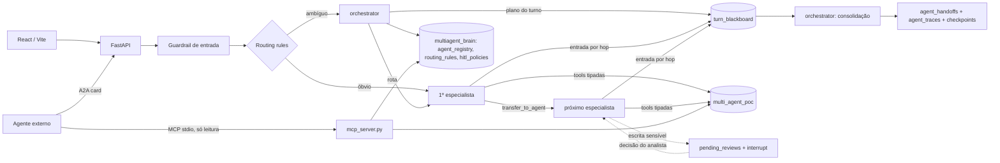
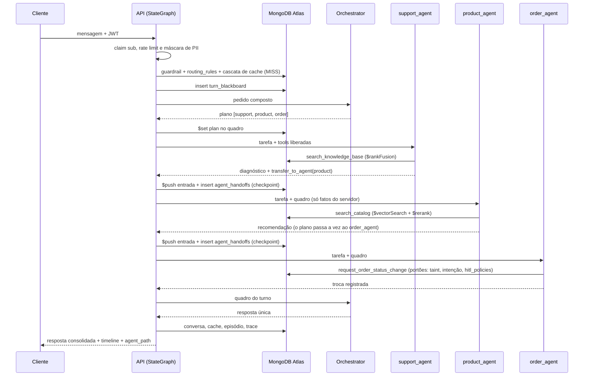

# Arquitetura

## Topologia

Especialistas: `order_agent`, `product_agent`, `support_agent`, `billing_agent`, `warranty_agent`,
`loyalty_agent`, `logistics_agent`. Cada um só enxerga as tools que `agent_registry.allowed_tools` libera.

## Fluxo de um turno com plano, quadro e consolidação

Se a escrita bate uma política de `hitl_policies` (reembolso; resgate alto, desligada no seed), o hop abre
`pending_reviews` e o grafo para em `interrupt()`; o cliente recebe `awaiting_approval`. A decisão do analista
retoma a thread daquele turno (gravada na revisão) e a escrita aprovada roda uma vez, no nó `apply_approved` (ADR-012).

Esse mesmo turno vira uma trace Langfuse opcional (`backend/app/langfuse_client.py`), com um span/generation por passo acima — ver seção de Observability no README.

## Limites de segurança

- O token define `customer_key`; campos de identidade do payload são ignorados.
- Filtros de pedido e fatura são reconstruídos do zero com ownership.
- Só quatro especialistas têm tool de escrita (`order_agent`: status de lista fechada; `loyalty_agent`: débito de pontos da tabela fechada; `logistics_agent`: `reschedule_requested`; `support_agent`: chamado). Toda escrita passa por taint de busca web, intenção explícita na mensagem do cliente e política de aprovação humana, nessa ordem; o modelo só passa ids validados e enums fechados.
- O próximo agente recebe do quadro do turno só fatos gerados pelo servidor; o texto de outro modelo nunca entra no prompt de um agente.
- O servidor MCP só expõe tools de leitura, com identidade do JWT revalidada a cada chamada; o agent card A2A não leva modelo, orçamento nem config de retrieval.
- O plano `multiagent_brain` é alterado somente pelos endpoints administrativos.
- Conversas são bounded a 20 mensagens e expiram em 24 horas; eventos e auditoria expiram em 30 dias.
- `conversation_id` e memória de curto prazo são validados junto com o `customer_key`; conhecer um ID não permite retomar ou sobrescrever a conversa de outro cliente.

## Retrieval

- Catálogo: `autoEmbed` com `voyage-4`, `indexingMethod: flat` e filtros `active`, `category`, `price`.
- Base de suporte: um `$rankFusion` no servidor (perna vetorial + BM25 `lucene.portuguese` com sinônimos `kb_sinonimos` e fuzzy em cláusulas separadas, filtro opcional de categoria nas duas pernas), config viva em `agent_registry.support_agent.retrieval.fusion`, `scoreDetails` por artigo na timeline; cascata `rankFusion` → `rankFusion_basico` → `rrf_aplicacao` → `vetor` → `rrf_local` (ADR-006). `$scoreFusion` existe como opção de dado (`retrieval.fusion.method: "score"`) e foi medido pior neste KB. `$rerank` por agente no registry: ligado no catálogo, desligado no KB (ADR-007).
- Economia de LLM: time series `llm_usage_ts` (meta agente/modelo/área, granularity minutes, TTL 90 dias), agregada por janela em `/api/economics` (ADR-008).
- Feed de handoffs: change stream com filtro de dono no `$match` do servidor, resume token por assinante, `resync`, teto de assinantes (ADR-009). Turno ao vivo em `POST /api/chat/stream`.
- Memória longa: um documento por fato, com `customer_key + active` no índice vetorial.
- Cache curto: índice vetorial particionado por `session_id + customer_key + agent`.

### Operadores em uso (auditado em 2026-08-18)

`$vectorSearch` (15 ocorrências), `$unionWith` (3 — a cascata de cache), `$search`/BM25 (1 — perna lexical da KB), mais o ranking ponderado do catálogo com `$addFields`/`$multiply` dentro da própria agregação. **Zero `$regex` em query.**

`find` aparece só em point lookup por índice (`order_id`, `invoice_id`, `customer_key`) e leitura de configuração no `multiagent_brain` — trocar isso por busca textual seria erro de modelagem. O diferencial não é evitar `find`: é o mesmo cluster ser data plane e coordination plane, sem fila, workflow engine ou vector DB ao lado.

Detalhe completo, com os pipelines colados, em [`docs/briefing/queries.md`](briefing/queries.md).
- Cache entre sessões: documentos `scope=customer` sempre filtram `customer_key`.
- Cache global: limitado a catálogo/KB sem memória personalizada, handoff ou escrita; garantia, pedido, cobrança, fidelidade e logística nunca são compartilhados entre clientes.
